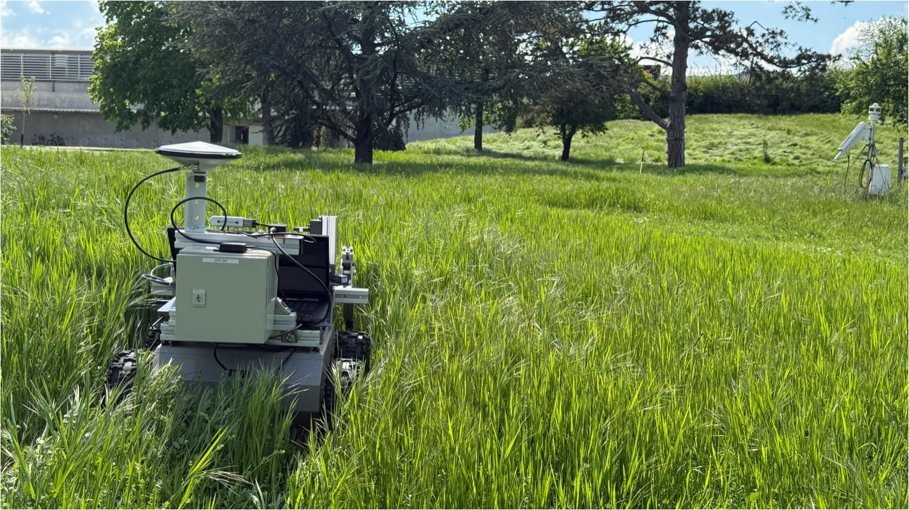
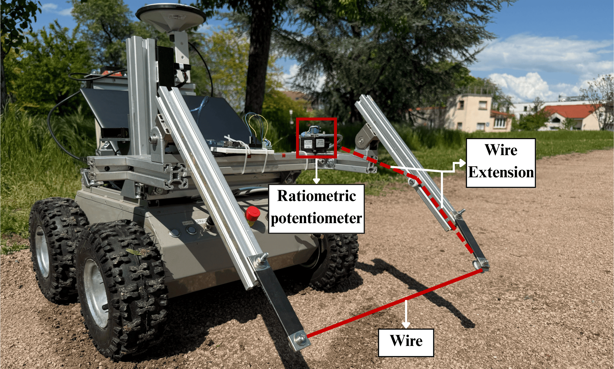
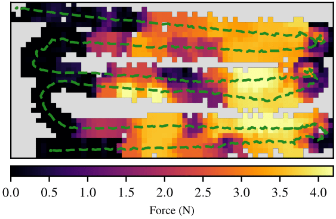

Vegetation can be traversable even when it appears as an obstacle in a geometric
map. This study measures the resistance exerted by plants on a moving robot,
providing information about contact that cameras and lidar do not directly measure.

## Force sensing

A tensioned wire mounted at the front of the robot moves when vegetation pushes
against it. Displacement measurements and a mechanical model are used to estimate
the contact force. The design limits internal friction so that small changes in
resistance remain measurable.

## Field measurements

Experiments with grass and a sapling demonstrate the sensor's response to
vegetation contact. Combining these measurements with the robot trajectory
produces a spatial map of the forces encountered during traversal.

The measurements can support the evaluation of traversability and future
navigation methods that account for plant resistance. The paper reports the
sensor design, model and experimental evaluation.


