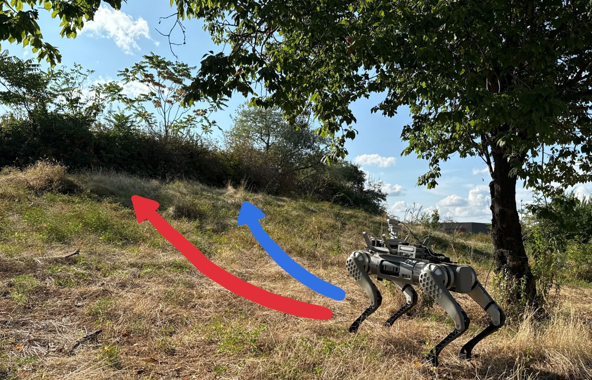
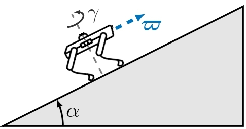
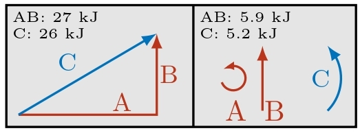
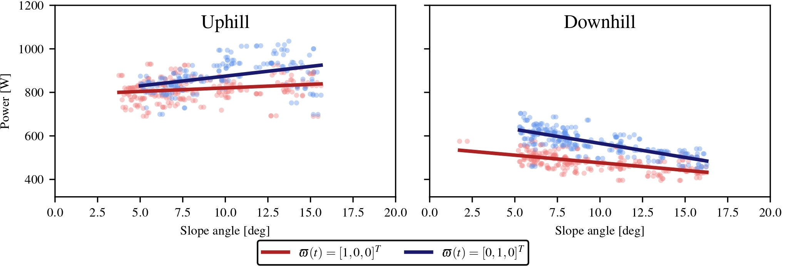

**Authors:** [Mohamed Ounally](/people/mounally/), Cyrille Pierre and [Johann Laconte](/people/jlaconte/).

**Publication:** 3D-Advice: Advanced 3D Vision for Complex Environments Workshop, 2025.

## Abstract

{{ page.paper.abstract }}

### Methodology and Setup

We used a Unitree B1 quadruped with standard sensors (battery monitor, IMU, odometry) on outdoor slopes ranging from 5° to 20°. The robot traveled at constant speed (0.3 m/s) along straight segments to minimize confounding effects.

  

The coordinate system establishes α as the slope angle and γ as the robot's heading relative to the slope direction. Energy is modeled as the integral of instantaneous power over the trajectory.

### Key Results

#### Energy Superposition Validation
The model treats energy as additive across path segments, validated through composite path experiments.

  

#### Power-Slope Relationships
Field experiments reveal clear linear trends with opposite behaviors for uphill versus downhill motion.

  

Measured power as a function of slope angle shows: power increases linearly when climbing, decreases moderately when descending, and lateral motion consistently requires more energy than forward motion.

### Key Findings

- **Linear power-slope relationships** with directional asymmetry
- **Energy additivity** across segments (4-13% accuracy)  
- **Sensor-only approach** using standard onboard systems
- **Directional anisotropy** favoring forward over lateral motion

### Applications

This energy model enables energy-aware path planning for agricultural robots, mission duration prediction, and optimization strategies that exploit directional energy asymmetries.

**Read and cite:** [Workshop paper (PDF)](/assets/papers/energy_prediction_slopes_2025.pdf) · [BibTeX](/assets/papers/energy_slopes_citation.bib) · [arXiv preprint (2026)](https://arxiv.org/abs/2603.11963)



[All publications](/publications/) · [More research](/research/)
