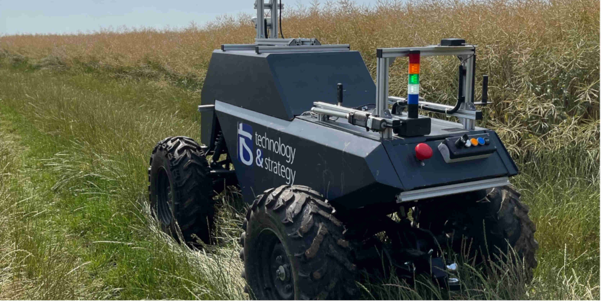
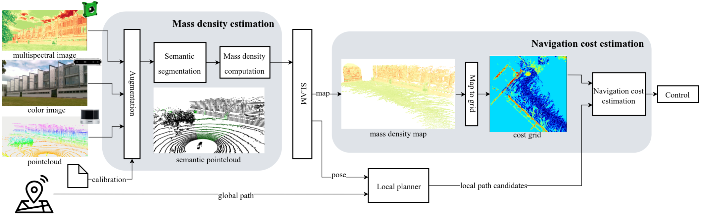

This study examines how geometric and multispectral measurements can help a
robot distinguish vegetation from rigid obstacles. The aim is to assess the
consequences of contact when planning a route through an agricultural environment.

A teleoperated platform collects lidar, depth and multispectral observations.
The method combines these observations in a map augmented with estimates of
vegetation mass density, then evaluates traversal through the predicted loss
of vehicle velocity.

The evaluation compares vegetation detection metrics, including the Normalized
Difference Vegetation Index (NDVI). It studies how the resulting representation
can inform collision-aware path assessment for different vehicle properties.
The paper describes the sensing pipeline, model and experimental conditions.


