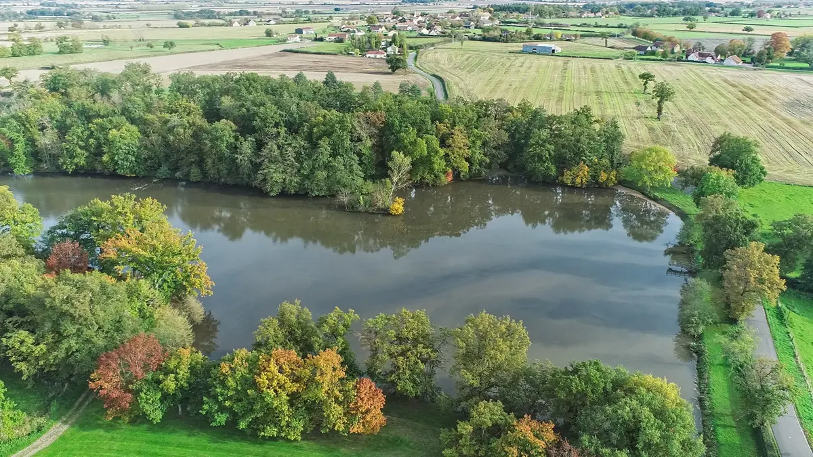

Below is a small collection of books I recommend reading, depending on your research project.
Don't hesitate to contribute to this list. Add the author, the topic and a link
to the book's official page, with a short note on when you found it useful.

## Purely Robotic Books
- "State Estimation for Robotics" by Tim Barfoot, [download here](http://asrl.utias.utoronto.ca/~tdb/)
- "A Mathematical Introduction to Robotic Manipulation" by Richard M. Murray, S. Shankar Sastry, and Zexiang Li, [download here](https://www.cse.lehigh.edu/~trink/Courses/RoboticsII/reading/murray-li-sastry-94-complete.pdf)

## Mathematical Foundations
- "Convex Optimization" by Lieven Vandenberghe and Stephen P. Boyd, [download here](https://web.stanford.edu/~boyd/cvxbook/)
- "Classical Mechanics" by John R. Taylor
- "Partial Differential Equations for Scientists and Engineers" by Stanley Farlow
- "Lie Groups, Lie Algebras, and Some of Their Applications" by Robert Gilmore, complemented by a nice reading of the book on [youtube](https://www.youtube.com/@XylyXylyX/courses)

## Lecture notes

- Johann Laconte, [A Small Introduction to Lie Groups for Robotics](https://hal.science/hal-04891869), 2024.
- Johann Laconte, [An Introduction to Path Planning and Convex Optimization for Control](https://hal.science/hal-04891897), 2025.
